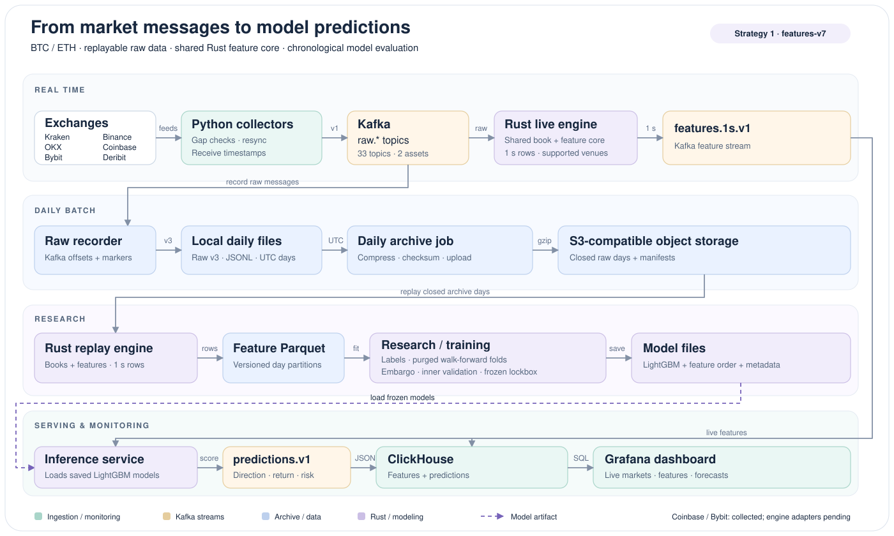
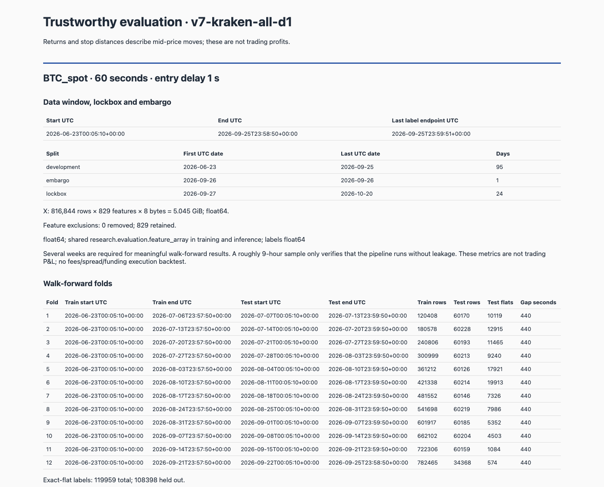

# BTC/ETH streaming analytics

Market messages become replayable archives, Rust features and evaluated LightGBM forecasts.
The same feature core powers offline research, live inference and a ClickHouse/Grafana dashboard.

**Strategy 1 release** · Collection + replay + serving implemented · Independent short-model lockbox pending

## Architecture



1. **Collect** — Python clients receive BTC/ETH feeds from six sources,
   check gaps, resynchronise connections and attach local receive timestamps.
2. **Stream** — Kafka raw topics buffer exchange messages and connection markers.
3. **Record** — The recorder writes raw-v3 JSONL files per channel, symbol and UTC day.
4. **Daily batch archive** — Closed files are compressed, checksummed and uploaded
   to S3-compatible object storage with day manifests.
5. **Replay features** — Rust reconstructs books and emits one-second feature rows
   to Parquet, preserving the information available at each tick.
6. **Train & evaluate** — Labels, purged walk-forward folds, paired comparisons
   and a frozen lockbox separate model fitting from evaluation.
7. **Live features** — The Rust live engine uses the same core and publishes `features.1s.v1`.
8. **Predict** — Inference loads saved models and publishes direction, return
   and adverse-move quantiles to `predictions.v1`.
9. **Monitor** — ClickHouse stores features/predictions; Grafana displays market
   conditions, book validity and forecasts.

## Data sources

BTC and ETH throughout. The [market configuration](config/markets.yaml) defines symbols and channels.

| Source | Markets | Feeds | Used by engine |
| --- | --- | --- | --- |
| Kraken | USD spot, perpetual | L2/L3 books, trades, ticker | Yes |
| Binance | USDT spot, perpetual | Quotes, depth, trades, mark/funding, liquidations | Yes |
| OKX | USDT spot, swaps | BBO, books, trades | Yes; swap scaling uses contract metadata |
| Coinbase | USD spot | Level 2, trades | Collected; parser pending |
| Bybit | USDT spot, linear perpetual | Depth 1/200, trades, ticker, liquidations | Collected; parser pending |
| Deribit | BTC/ETH volatility index | One-minute DVOL candles | Yes; per-asset cross rows |

Kraken L3 needs API credentials. Coinbase/Bybit are archived and excluded from engine assignment.
The reported Strategy 1 experiments use Kraken, Binance and Deribit inputs.

## Strategy 1 results

Kraken spot mid-price direction over 60/120 seconds; LightGBM, features-v7,
12 weekly out-of-fold development tests, one-second entry delay. Accuracy excludes flat outcomes.

| Target | Model | Reversal | Momentum | Top 5% confidence |
| --- | ---: | ---: | ---: | ---: |
| BTC · 60 s | 57.25% | 41.77% | 48.19% | 82.5% |
| BTC · 120 s | 56.63% | 46.02% | 48.76% | 76.1% |
| ETH · 60 s | 53.75% | 46.41% | 48.93% | 73.4% |
| ETH · 120 s | 53.61% | 48.76% | 48.70% | 67.2% |

Top-confidence signals average about 1.8 bps before costs; spread/slippage are excluded, and typical taker fees dwarf the move.
These are development results, not a standalone trading strategy; lockbox #2 is pending. [Methods, calibration and reproduction →](docs/strategy-1.md)

### Next: Strategy 2

In development, outside this release: first-touch ±0.5%/1 h and ±1%/4 h targets.
Needs longer-memory/positioning features, new-venue integration and lockbox #2 from new days ≥2026-10-21.

## UI



*Real `v7-kraken-all-d1` report: the earlier 829-input run, before constant-column removal; the results table uses the 415-input release run.*

A [live Grafana dashboard](docker/dashboard/README.md) also exists; its screenshot will be added.

## Quickstart

Requires Python 3.12, uv, Rust and Docker. Run from the repository root; the process helper uses macOS `caffeinate`.

**Collect locally**

```bash
uv sync
docker compose --env-file /dev/null -f docker/kafka/docker-compose.yml up -d
uv run python scripts/create_topics.py
scripts/pipeline.sh start
```

**Replay + train a minimal CPU baseline** — `ARCHIVE` and `WORK` are your input/output paths.
Use the [release recipe](docs/strategy-1.md#how-to-reproduce) for the final model parameters.

```bash
scripts/train_offline.sh ARCHIVE WORK --jobs 2 --replay-only
PYTHON_DOTENV_DISABLED=1 uv run python -m research.train WORK \
  --label-spec research/targets_kraken_short.yaml --version quickstart \
  --target BTC_spot --horizon-s 60 --lockbox-from 2026-09-27
```

**Tests**

```bash
PYTHON_DOTENV_DISABLED=1 uv run pytest -q
(cd engine && cargo test --release --locked)
(cd engine && cargo clippy --release --locked --all-targets -- -D warnings)
```

Stop/status commands, object archiving, full training/comparison commands, DVOL and live-service setup are in [operations](docs/operations.md).

## Repository layout

```text
archiver/     Raw recording, v3 format, daily object archive
collectors/   Exchange clients and shared connection lifecycle
config/       Markets, topic routing, event calendar
dashboards/   Grafana market dashboard
docs/         Strategy, operations, architecture and historical notes
docker/       Kafka, ClickHouse and Grafana configuration
engine/       Rust core, replay and live engine
inference/    Saved-model streaming prediction service
infra/        Optional AWS Terraform deployment
ops/          Optional macOS archive scheduling
research/     Labels, matrices, training and evaluation
scripts/      Operations, audits and offline launcher
tests/        Python tests and recorded/synthetic fixtures
```

## Documentation

[Strategy 1](docs/strategy-1.md) · [Operations](docs/operations.md) · [Documentation index](docs/README.md)

[Engine](engine/README.md) · [Research](research/README.md) · [Dashboard](docker/dashboard/README.md) · [Historical notes](docs/archive/README.md)
