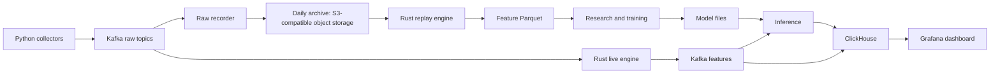
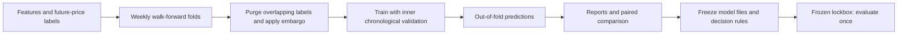

# BTC/ETH market data and short-horizon forecasting

A personal quant research project that follows Bitcoin and Ether market data from
collection to model predictions. Python collectors send exchange messages through
Kafka into a raw archive; a shared Rust engine reconstructs books and computes
features for both offline replay and live use. Python research code builds labels,
trains LightGBM models and compares predictions on later, unseen weeks. A local
ClickHouse/Grafana stack displays features and inference output.

**Status — Strategy 1 release:** collection, archiving, replay, training and live
inference/dashboard components are implemented. The 1–2 minute direction models
have development-fold results; their next independent lockbox evaluation is pending.
This is a research and execution-timing signal, with no claim of net trading profit.

## How the pieces fit



The recorder first writes local, per-channel UTC-day files. The daily archiver
compresses closed files, uploads them and records checksums in a day manifest.
Offline work needs an archive copy and CPU resources; it needs no running broker
or exchange connection. Live and replay share book and feature calculations.



Out-of-fold (OOF) means each scored row comes from a model trained on earlier
observations. Inner validation chooses the number of trees and confidence cutoffs;
outer test weeks measure performance. The lockbox is a separate date range kept
out of model selection. [Research documentation](research/README.md) explains the
evaluation controls and saved artifacts.

## What is collected

The configured assets are BTC and ETH. A perpetual contract is a derivative
without an expiry date; a spot market trades the asset itself.

| Source | Spot | Perpetual / index | Rust engine today |
| --- | --- | --- | --- |
| Kraken | BTC/USD, ETH/USD; L2 book, L3 orders, trades | PF_XBTUSD, PF_ETHUSD; book, trades, ticker | Spot and perpetual books/flows/extras |
| Binance | BTCUSDT, ETHUSDT; best quotes, depth + REST snapshots, trades | USDⓈ-M; same books/trades, aggregate trades, mark/funding, liquidations | Spot and perpetual; fast best-quote mids for lead features |
| OKX | BTC-USDT, ETH-USDT; BBO, books, all trades | USDT swaps; BBO, books, trades and all trades | Spot/swap books and trades; swap quantities require contract metadata |
| Coinbase | BTC-USD, ETH-USD; level2, market_trades | — | Collected and archived; engine adapter pending |
| Bybit | BTCUSDT, ETHUSDT; depth 1/200, publicTrade | Linear contracts; same books/trades, tickers, allLiquidation | Collected and archived; engine adapter pending |
| Deribit | — | BTC/ETH DVOL one-minute volatility-index candles | DVOL and changes on per-asset cross rows |

The source of truth is [config/markets.yaml](config/markets.yaml). Kraken L3
requires API credentials; the other configured feeds use public endpoints.
Without the Kraken key, its L3 connection is skipped. Sequence/checksum checks,
connection markers and reconnects make interruptions visible in the archive.

**Raw format v3:** native JSON with exact decimal token strings, receive time,
connection ID and Kafka offset, under
`data/raw/<Exchange>/<Spot|Futures|Index>/<Pair>/YYYYMMDD_<channel>.jsonl`.
Kafka envelopes remain v1. Raw files are replayable records, rather than a
normalized table of prices; control markers describe connection changes.

OKX parsing exists already, but the Strategy 1 results below use the historical
Kraken/Binance/Deribit inputs. Coinbase and Bybit are excluded from live-engine
assignment until their parsers exist. Current configuration creates 33 raw topics
with two asset partitions each; the engine consumes the 46 supported partitions.

## Strategy 1: 1–2 minute direction

The model predicts whether Kraken spot BTC/USD or ETH/USD mid-price will go down,
stay exactly unchanged, or go up over 60 or 120 seconds. It also estimates the
move and adverse-move quantiles for long and short positions. The engine supplies
features-v7, including 20 cross-venue lead features; LightGBM uses small,
regularised trees. See [Strategy 1](docs/strategy-1.md) for the full explanation,
example prediction, calibration, experiments and reproduction commands.

These are OOF results across 12 weekly development folds, with a simulated
one-second entry delay. Accuracy excludes actual flat outcomes. Confidence
subsets use thresholds chosen on each fold's inner validation period.

| Kraken target | Model | Reversal | Momentum | Top 50% confidence | Top 20% | Top 5% |
| --- | ---: | ---: | ---: | ---: | ---: | ---: |
| BTC, 60 s | 57.25% | 41.77% | 48.19% | 68.6% | 75.6% | 82.5% |
| BTC, 120 s | 56.63% | 46.02% | 48.76% | 63.3% | 68.9% | 76.1% |
| ETH, 60 s | 53.75% | 46.41% | 48.93% | 59.0% | 65.3% | 73.4% |
| ETH, 120 s | 53.61% | 48.76% | 48.70% | 56.9% | 60.8% | 67.2% |

High hit rates do not imply large returns. The top-5% signals average about
1.8 basis points in the predicted direction before costs, too small for a
standalone strategy at typical low-volume taker fees. These are mid-price
measurements without spread or slippage. Lockbox #1 (2026-09-27–2026-10-20) was
already used for earlier five-minute models; lockbox #2 is pending for these models.

## Next: Strategy 2

**In development; outside this release.** The next research target is a big-move
model: which barrier is touched first, ±0.5% within one hour and ±1% within four
hours. It needs longer-memory and positioning features, Coinbase/Bybit engine
support, and integration/validation of new OKX archive inputs through the existing
parser. Evaluation will use lockbox #2, drawn from new days on or after
2026-10-21, after sufficient data is collected and the candidate is frozen.

## Quickstart: collect and record locally

Use Python 3.12, uv and Docker. The process helper is for macOS and uses
`caffeinate`; its logs and PID files go under `data/logs` and `data/state`.
Run these commands from the repository root:

```bash
uv sync
# Export Kraken API settings if L3 collection is wanted.
docker compose --env-file /dev/null -f docker/kafka/docker-compose.yml up -d
uv run python scripts/create_topics.py
scripts/pipeline.sh start
scripts/pipeline.sh status
uv run python scripts/check_raw.py
# Later: scripts/pipeline.sh stop
```

The helper starts six collectors and the raw recorder. Kafka listens at
`localhost:9092`, with its UI at `http://localhost:8080`. Optional inference starts
when `INFERENCE_MODEL_VERSION` is set. Configure `DATA_DIR` and other settings
through exported variables or a local environment file. Closed days have metadata
sidecars; files still being written end in `.open`.

For remote archiving, configure `S3_BUCKET` and the SDK's access/endpoint settings,
then run `uv run python -m archiver.archive_daily --date YYYY-MM-DD`.
`--verify YYYY-MM-DD` downloads and verifies a completed day. The code uses the S3
API; [infra/terraform](infra/terraform/) contains the AWS deployment configuration.
The normal local collection quickstart does not require object storage.

## Replay and train offline

Use a batch/HPC machine for a multi-month archive, or a local machine for small
samples. Install uv/Python and Rust, run `uv sync`, and provide a raw archive root.
`ARCHIVE` and `WORK` below stand for paths you choose. Keep a separate work root
for each feature engine version or replay clock.

```bash
# Build once, then replay one closed UTC day.
(cd engine && cargo build --release --locked -p engine-replay)
engine/target/release/engine-replay --root ARCHIVE --date 2026-09-25 \
  --out WORK/features

# Or replay a date range in bounded parallel jobs, without training yet.
scripts/train_offline.sh ARCHIVE WORK --jobs 2 \
  --from 2026-06-23 --to 2026-10-20 --replay-only

PYTHON_DOTENV_DISABLED=1 uv run python -m research.train WORK \
  --version strategy-1 --label-spec research/targets_kraken_short.yaml \
  --target BTC_spot --target ETH_spot --horizon-s 60 --horizon-s 120 \
  --early-stopping --rounds 1000 --lockbox-from 2026-09-27 \
  --entry-delay-s 1 --fold-days 7 --max-folds 12 \
  --params '{"num_leaves":7,"min_data_in_leaf":2000,"feature_fraction":0.5,"bagging_fraction":0.7,"bagging_freq":1,"lambda_l2":10}'

# Compare saved model directories or OOF Parquet files on identical rows.
PYTHON_DOTENV_DISABLED=1 uv run python -m research.compare A B
```

Replay writes `WORK/features/date=YYYY-MM-DD/features.parquet`. Training saves
models, metadata and `oof.parquet` under `WORK/models/<target>/<seconds>/<version>`;
JSON/HTML reports and experiment/lockbox ledgers live under the work root.
Versions are never overwritten. The launcher can also train directly with its
supported flags; use the separate Python command for `--params` and early stopping.
Use `python -m research.train --help` for all controls. The commands above keep
the lockbox closed; freezing and opening it is a separate, deliberate operation.

<a id="deribit-dvol-p22-features-v5"></a>
### Deribit DVOL

The collector polls closed one-minute BTC/ETH implied-volatility candles. Replay
adds DVOL levels/changes and a realised-volatility gap to cross rows. The
[feature contract](engine/replay/README.md#deribit-dvol-features-v5) defines causal
availability and staleness. For a separate historical archive, the server-side
`scripts/backfill_dvol.py --help` explains receive-day backfill; it refuses to
overwrite existing archive content.

## Live features, inference and dashboard

Build with `(cd engine && cargo build --release --locked)`, then run
`engine/target/release/engine-live --root data` against the local broker.
It starts at the latest supported raw offsets, emits `features.1s.v1`, and records
checkpoints/cutoffs for reproducible `as_live` replay. It waits for fresh snapshots;
a restart does not automatically restore the previous session.

Run `uv run python -m inference.service --models-root WORK --version strategy-1`
to consume features and publish `predictions.v1`. Model files and saved metadata
must match the feature schema. Start ClickHouse/Grafana with the instructions in
[dashboard operations](docker/dashboard/README.md); Grafana is at
`http://127.0.0.1:3000`. These are local development services. See
[engine documentation](engine/README.md) for timing and recovery limits.

## Tests

```bash
PYTHON_DOTENV_DISABLED=1 uv run pytest -q
# With an existing uv environment: PYTHON_DOTENV_DISABLED=1 .venv/bin/python -m pytest -q
(cd engine && cargo test --release --locked)
(cd engine && cargo clippy --release --locked --all-targets -- -D warnings)
(cd engine && cargo fmt --check)
```

Python tests exercise collectors, recorder/archive, labels, evaluation and serving
with fixtures and stubs. Rust tests cover book reconstruction, feature semantics,
archive replay and live/replay parity. They do not require live exchange access.

## Repository layout

```text
archiver/     Raw recording, v3 format and daily object-storage archive
collectors/   Exchange clients, connection lifecycle and Kafka envelopes
config/       Markets, topic routing and scheduled event calendar
dashboards/   Grafana market dashboard definition
docs/         Strategy write-up and indexed historical research notes
docker/       Local Kafka, ClickHouse and Grafana service configuration
engine/       Shared Rust core, offline replay and live engine
inference/    Saved-model loading and streaming prediction service
infra/        Terraform object-storage infrastructure
ops/          macOS launchd archive scheduling template
research/     Label specs, matrices, LightGBM training and comparisons
scripts/      Collection helpers, audits, conversion and offline launcher
tests/        Python tests and small recorded/synthetic fixtures
```

Start with [Strategy 1](docs/strategy-1.md), then [engine/README.md](engine/README.md)
and [research/README.md](research/README.md) for implementation detail. The
[docs index](docs/README.md) separates the release description from historical notes.
