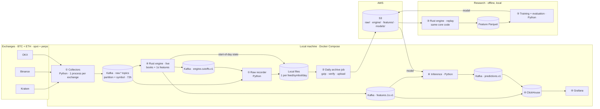

# Project plan: BTC/ETH market data → 15/30-minute predictions

Updated 2026-10-17 (after review rounds 1–3; settled). This is the **only** plan. Edit it in place. Nothing below is built yet, apart from the legacy files in §12. The review history is in §14.

## 1. Goal

Collect BTC and ETH **spot + perpetual** data from Kraken, Binance and OKX, 24/7. Keep a raw, replayable archive. Later, predict direction and % return over the next 15 and 30 minutes, for **both spot and perp** prices. Compute runs locally; AWS is used **only for S3 storage**.

Principles:
1. **Raw first:** store every message exactly as received, wrapped with our local receive time. Everything else can be rebuilt from it.
2. **One engine, reproducible:** the same Rust code computes features live and on history. Replay reproduces exactly what live knew (§8).
3. **No look-ahead:** a feature at time *t* uses only data our collectors had received by *t*.
4. **Every day replays on its own:** day D's folder alone (raw files + the engine's start-of-day state) is enough to rebuild day D. Data never moves between days (§5.4, §8).
5. **Measure, don't assume:** volume, disk, latency and cost are measured in phase 1 onward.

## 2. Architecture



The circled numbers are build phases (§11). The recorder and the engine read Kafka independently, so recording continues if the engine or dashboard fails. The live engine publishes its **cutoffs** (what it had read at each tick), and they are archived so replay can reproduce live exactly.

## 3. Components

| Component | Role | Tech |
|---|---|---|
| Collectors | WebSocket/REST → envelope (+ local receive time) → Kafka; keepalive, reconnect, gap detection, resync, rotation | Python 3.12, asyncio, `websockets`, `httpx`, `orjson`, `confluent-kafka` |
| Kafka | Replayable buffer; several readers consume the same data independently | 1 KRaft broker in Docker |
| Raw recorder | Kafka → local JSONL, one file per (topic, partition) per UTC day | Python, `confluent-kafka` |
| Daily archive job | Closed day files → `.jsonl.gz` → S3 + manifest | Python, `boto3`, macOS launchd |
| Rust engine | `core` (books, features; no I/O) + `live` (Kafka) and `replay` (files → Parquet) | Rust |
| ClickHouse + Grafana | Dashboard; ClickHouse ingests Kafka topics directly via its Kafka table engine | Docker |
| Training / inference | Models on replayed features / live predictions | Python |
| Terraform | S3 bucket, least-privilege IAM, budget alert | Terraform |

Why the recorder exists: Kafka's own log files are binary, split by size, and deleted after retention. The recorder is how data is saved as readable daily files.

## 4. What we collect

**Markets:**
- **Kraken:** spot `BTC/USD`, `ETH/USD`; perp `PF_XBTUSD`, `PF_ETHUSD`.
- **Binance:** spot and USDⓈ-M perp `BTCUSDT`, `ETHUSDT`.
- **OKX:** spot `BTC-USDT`, `ETH-USDT`; perp `BTC-USDT-SWAP`, `ETH-USDT-SWAP`.

Every record carries exchange, market and native symbol. USD/USDT and spot/perp are never mixed silently.

**Feed → native channel** (the feed name is used in topics and file paths):

| Feed | Kraken spot | Kraken perp | Binance spot | Binance perp | OKX spot | OKX perp |
|---|---|---|---|---|---|---|
| `l1` best bid/ask | (derived from L2) | — | `bookTicker` | `bookTicker` | `bbo-tbt` | `bbo-tbt` |
| `l2` book levels | `book` depth 100 | `book` | `depth@100ms` + REST snapshot (5000) | `depth@100ms` + REST snapshot (1000) | `books` (400) | `books` (400) |
| `l3` individual orders | `level3` depth 100 | — | — | — | — | — |
| `trades` individual | `trade` | `trade` | `trade` | `trade` | `trades-all` | `trades-all` |
| `trades_agg` aggregated | — | — | — | `aggTrade` | — | `trades` |
| `mark` mark/funding | — | — | — | `markPrice@1s` | — | — |
| `liquidations` | — | — | — | `forceOrder` (sampled, see below) | — | — |
| `ticker` funding/OI/mark | — | `ticker` | — | — | — | — |

That's 22 feeds × 2 symbols = **44 data streams, i.e. 44 files/day**.

**Connections:**

| Exchange | URL | Carries |
|---|---|---|
| Kraken spot | `wss://ws.kraken.com/v2` | book, trade |
| Kraken L3 | `wss://ws-l3.kraken.com/v2` | level3 (auth token required) |
| Kraken futures | `wss://futures.kraken.com/ws/v1` | book, trade, ticker |
| Binance spot | `wss://stream.binance.com:9443/stream` + REST `api.binance.com/api/v3/depth` | all spot streams |
| Binance perp | `wss://fstream.binance.com/public/stream` | depth, bookTicker, trade |
| Binance perp | `wss://fstream.binance.com/market/stream` + REST `fapi.binance.com/fapi/v1/depth` | aggTrade, markPrice, forceOrder |
| OKX | `wss://ws.okx.com:8443/ws/v5/public` | bbo-tbt, books, trades |
| OKX | `wss://ws.okx.com:8443/ws/v5/business` | trades-all |

**Binance perp routing:** a stream on the wrong path (`/public` vs `/market`) silently sends nothing. The legacy unrouted URLs were shut down on 2026-04-23. Paths were tested ad hoc on 2026-10-17 and the output was not saved. The phase 1 probe output (`tests/fixtures/probe-summary.json`) becomes the stored evidence. `forceOrder` was silent during that short test; its path follows Binance's docs.

**Liquidations are sampled:** Binance `forceOrder` pushes only the latest liquidation per symbol in each 1-second window. Use it as an activity signal, never as complete liquidation volume.

## 5. Collector rules

### 5.1 Envelope and control events
Every message is wrapped in an envelope. `recv_ns` is our **local receive time**: the UTC epoch in nanoseconds, taken from the Mac's NTP-synced clock the moment the frame arrives. Stamping and handing the message to the Kafka producer happen in one step, so each stream's records are always in receive order.

```json
{"v":1,"exchange":"binance","market":"spot","feed":"l2","symbol":"BTCUSDT",
 "kind":"update","conn":"7f3c…","seq":18233,"recv_ns":1792195200123456789,
 "payload":"<raw frame text, byte-for-byte>"}
```

- **`kind` values:**
  - `snapshot`: WebSocket or REST book snapshot.
  - `update`: book deltas, L1, mark price, ticker.
  - `trade`
  - `control`
- **`conn` + `seq`:** `conn` is a per-connection ID; `seq` is that connection's counter. Together they are unique.
- **`payload`:** never parsed and re-serialized, so exact decimals survive and checksums can be re-verified.
- **What is not stored:** heartbeats and pongs. Subscription acks are embedded in `start`.

**Control events have exactly three types:**
- `start`: connection open and subscribed. It includes the URL, the subscription ack and instrument metadata (contract, tick and lot size).
- `stop`: clean close, e.g. a planned rotation.
- `drop`: unexpected loss. `reason` is one of `disconnect` | `sequence_gap` | `checksum_mismatch` | `kafka_unavailable` | `collector_crash`, with `detail` such as expected vs. received IDs.

A sequence or checksum failure is treated like a disconnect: `drop` → resync → `start` → new snapshot.

```json
{"v":1,"exchange":"binance","market":"spot","feed":"l2","symbol":"BTCUSDT",
 "kind":"control","event":"drop","reason":"sequence_gap","conn":"7f3c…","seq":18234,
 "recv_ns":1792195200223456789,"detail":{"local_id":881,"got_U":905}}
```

**Control events are written in-band.** A control event goes into **every (feed, symbol) stream that the connection carries**, in the same Kafka partition and file as the data. Its position relative to the data is therefore exact, and it is archived to S3 automatically. There is no separate control topic. **Replay rule:** after a `drop`, that stream's book is invalid until the next `start` + snapshot.

### 5.2 Gap checks (then resync)
- **Binance spot:**
  1. Buffer events, then take the REST snapshot.
  2. Drop events with `u ≤ lastUpdateId`. The first applied event must satisfy `U ≤ lastUpdateId+1 ≤ u`.
  3. After that, ignore events with `u < local_id`. If `U > local_id + 1`, it is a gap. Otherwise apply the event and set `local_id = u`.
  4. This range rule accepts valid overlapping updates. A gap means re-snapshot.
- **Binance perp:** after the snapshot, the first event must satisfy `U ≤ lastUpdateId ≤ u`. After that, each event's `pu` must equal the previous `u`. A mismatch means re-snapshot.
- **OKX `books`:** `prevSeqId == last seqId`. A break means resubscribe.
- **Kraken spot L2/L3:** CRC32 checksum on the top 10 levels. A mismatch means resubscribe.
- **Kraken futures `book`:** `seq` must increase by exactly 1. A gap means resubscribe.
- **Trades:** IDs must be unique per (exchange, market, symbol). This check is used for de-duplication, not for gap detection.

### 5.3 Reconnects and Kafka outages
- **Reconnect:**
  - Retry with exponential backoff and jitter (1s → 60s cap).
  - Respect per-exchange connection limits, set in config. Example: OKX allows 3 connection requests per second per IP.
  - Each new connection gets a new `conn`. It emits `start` and starts with fresh snapshots.
- **Kafka outage or collector crash: memory only, risk accepted for v1 (user decision).**
  - **Normal operation:** a message spends only milliseconds in the producer's memory (`linger.ms` ≈ 10).
  - **The buffer only fills while Kafka is unreachable** (Docker Desktop restart or update, Kafka crash, full disk). Its cap is a ceiling, not an amount always held. It is sized from the measured data rate to hold at least 10 minutes.
  - **If Kafka is gone longer than the cap:** new messages are discarded. Once Kafka is back, the collector writes `drop(reason=kafka_unavailable)` → `start` → re-snapshot for each affected stream.
  - **Accepted risk:** if the collector process itself crashes, whatever is still in its memory is lost before a `drop` can be written. That is normally about 10 ms of data; during a Kafka outage it can be the whole buffer.
  - **Crash detection:** each collector keeps `data/state/collector-<exchange>.json` holding `session`, `status` (`running`/`stopped`) and `last_alive_ns`, updated every few seconds.
    - On startup, a previous `running` status means that session crashed.
    - The new session first writes `drop(reason=collector_crash, detail={prev_session, prev_last_alive_ns})` into every stream it carries, then `start`.
    - Coverage between the old session's last archived record and that `drop` is **uncertain**, and `check_raw` reports it.
  - **No disk spool in v1.** Revisit in phase 7 if measured outages exceed the buffer.

### 5.4 Day boundaries

Day D = 00:00:00 to 23:59:59.999 UTC, by `recv_ns`. Each day stands alone: no day-D record is stored in another day's files (one counted exception: a clock step-back, rule 1).

1. **File assignment (recorder):** a record goes to the file for the UTC date of its `recv_ns`. If the Mac clock steps back across midnight, such records stay in the current file and are counted as `foreign_day_records` in its `.meta.json`; the engine routes them by `recv_ns`.
2. **Day close (recorder):** a stream's day-D file closes when that stream delivers its **first day-D+1 record**.
   - Each stream is in receive order (§5.1), so no day-D record can come after that.
   - Rule 3 gives every stream a day-D+1 record (the new connection's `start`) within seconds of midnight.
   - If Kafka, the recorder or a collector is behind or down, the close simply waits for it to catch up.
   - **Never force-closed.** If a day-D file is still open at 06:00 UTC, the daily job reports the day as **overdue** and keeps it `provisional`. Its messages may still be waiting safely in Kafka. The day is finalized only after confirmed catch-up. A stream retired on purpose is closed with an explicit operator command.
3. **Midnight connection replacement (collector), make before break:** just after 00:00 UTC, replace every connection, staggered by a few seconds per exchange to respect rate limits.
   1. Open the new connection B and subscribe. B writes `start` into each of its streams and gets fresh snapshots (for Binance books: a REST snapshot + sync on B).
   2. Keep the old connection A running until B has delivered a snapshot (book feeds) or a first message (other feeds) for every stream, or until 30s pass.
   3. Write `stop(reason=rotation)` for A, then close A.

   The same procedure runs when a Binance connection reaches **23h of age** (a margin before Binance's 24h limit) and on manual restarts.
4. **Overlap (engine):** for each stream, A stays the active connection until B's first snapshot (books) or B's first message (other feeds). After that, A's messages are ignored. Trades are also de-duplicated by trade ID.

In a day-D replay, books start from B's first snapshot, and book features for the first few seconds of the day are flagged invalid. Rolling-window features need the engine's start-of-day state (§8).

### 5.5 Other exchange rules
- **Kraken L3 token:** REST `GetWebSocketsToken`, signed with a key that has **only** WebSocket permission. Key and secret live in `.env`. Fetch a fresh token per connection; it must be used within 15 minutes.
- **Keepalive:**
  - OKX: send `ping` after 25s idle (it disconnects at 30s).
  - Kraken spot: `{"method":"ping"}`.
  - Kraken futures: regular pings (the probe confirms the timeout).
  - Binance: pong is automatic.
- **Units:** OKX swap sizes are in contracts (1 = 0.01 BTC / 0.1 ETH). Binance and Kraken perp sizes are in coins.
- Binance spot `bookTicker` has no exchange timestamp; `recv_ns` is its only clock.
- Pick one canonical trade feed per market. Never sum `trades` and `trades_agg` volume.

## 6. Kafka

- **Topics:** `raw.<exchange>.<spot|perp|index>.<feed>.v1` (23 topics). Also:
  - `engine.cutoffs.v1` (phase 4);
  - `features.1s.v1`, `predictions.v1` (phases 4 and 6).
- **Partitions:** 2 per raw topic with an **explicit mapping from config: BTC → 0, ETH → 1** (no hashing). Each (topic, partition) is exactly one (feed, symbol) stream, so ordering and recorder recovery work per stream.
- **Retention:** 72h plus a per-topic size cap, sized from the phase 1 measurements. Auto-create is off; topics are created by a script.
- **Producer:** `acks=all`, idempotent (keeps per-partition order through retries).
- **Never recreate a topic.** Archived offsets and engine cutoffs refer to it. If a reset is unavoidable, bump the suffix (`.v2`).
- **Listeners:**
  - `EXTERNAL://localhost:9092` for programs on the Mac (collectors, recorder, scripts).
  - `INTERNAL://kafka:29092` for containers on the Docker network (ClickHouse, later containerized services).
  - A separate controller listener.

## 7. Storage

```text
Local: data/raw/<Exchange>/<Spot|Futures|Index>/<SYMBOL>/YYYYMMDD_<channel>.jsonl   (.open while writing)
       data/engine/date=YYYY-MM-DD/cutoffs.jsonl, start_state.bin, carry_in.jsonl (phase 4)
       data/state/collector-<exchange>.json                                     (crash detection; not archived)
S3:    raw/… and engine/… (same paths, .jsonl.gz) · manifests/date=YYYY-MM-DD.json
       features/date=…/*.parquet · models/<name>/<version>/
```

**Recorder** (one file per (topic, partition) per day):
- Raw format v3 wraps native data with `channel`, `recv_time_ns`, `conn` and
  Kafka `offset`; Kraken spot injects metadata into its native object. Decimal
  JSON number tokens become exact strings, with integers kept as integers.
  Kafka envelopes remain v1. Invalid/colliding native objects retain exact `raw`
  text. Closed files end with a rollover marker and have `.meta.json`.
- Deribit index uses `Deribit/Index/<BTC|ETH>/YYYYMMDD_dvol.jsonl` and a wrapped
  `data: [ts_ms,open,high,low,close]` array. Directory prefixes are case-insensitive.
  Day assignment remains by receive time, including synthetic backfill receives.
- Calls `fsync` every few seconds, then commits Kafka offsets. Commits are only used for monitoring lag.
- **Recovery:** the files are the source of truth.
  1. For each (topic, partition), open its newest file and truncate a partial last line.
  2. Read the last offset in that file and resume from offset + 1.
  3. If the partition has no file yet, use the committed offset, or else the earliest retained offset.

  Because each partition writes to exactly one file at a time, in order, a restart creates **no duplicates and no holes**, as long as Kafka still retains the data (72h).
- **Closing:** a file closes per the §5.4 day-close rule. On close, write `.meta.json`: line count, first/last offset, time range, sha256.

**Daily job (from 00:15 UTC, then hourly until day D is complete):**
1. gzip each closed day-D file (streamed), test-read it, and upload it with a SHA-256 checksum. Re-uploading is harmless (same key, same checksum).
2. While any of day D's 46 streams' channel files or its engine files is still open, write `manifests/date=D.json` with `"status":"provisional"`, listing what is uploaded and what is pending. An outage delays completion; it never moves data to another day.
3. Once every file for day D is closed and uploaded, rewrite the manifest as `"status":"complete"`, with per-file counts, offsets and sha256. Only `complete` days are used for training.
4. Delete local copies 48h after `complete`. Missed days are caught up automatically.

**S3:** a private, encrypted bucket on S3 Standard, with a budget alert (e.g. $10/month). Until a day is uploaded, it exists only on the local disk.

## 8. Rust engine

`engine/core` (books + features, no I/O) · `engine/replay` (files → Parquet) · `engine/live` (Kafka → features).

- **Ticks:** features are computed for tick time T, every whole UTC second. Tick T runs at wall time T + 250 ms (configurable), which gives messages time to reach Kafka. At each tick the engine:
  1. reads what has arrived and takes **only messages with `recv_ns ≤ T`**; later messages wait for the next tick;
  2. applies them in the fixed order `(recv_ns, topic, partition, offset)`, which also breaks ties between equal timestamps;
  3. emits features for T with `available_ns` = emission time, the earliest moment a model may use them;
  4. publishes the **cutoff** `{tick_ns: T, engine_version, processed: {topic/partition: last processed offset}}` to `engine.cutoffs.v1`, where it is archived.

  A message with `recv_ns ≤ T` that reached Kafka too late is processed at the next tick, and the cutoffs record that.
- **Start-of-day state:** as of 00:00:00 UTC, before processing day D's first tick, live writes a checkpoint to `data/engine/date=D/start_state.bin`, versioned by `engine_version` and archived with day D. It contains:
  - books;
  - rolling windows (returns, volatility, trade flow);
  - the active connection per stream;
  - the cutoff it continues from.
- **Carry-in:** some day-D−1 messages are processed by day-D ticks, for example ones received at 23:59:59.9 or delivered late after an outage. Live copies those raw records into `data/engine/date=D/carry_in.jsonl`, next to the start state. The originals stay unchanged in D−1's files. A stream's carry-in is complete once live has processed that stream's first day-D record (the same rule as the day close).
- **Replay modes:**
  - `as_live`: start from day D's start state, add its carry-in, and reuse its cutoffs. The output is identical to live; this is the parity test.
  - `ideal`: for periods with no cutoffs or start state (before phase 4, or while the engine was down). Tick T takes messages with `recv_ns ≤ T`. A single-day replay flags rolling-window features as **warm-up** for the first N minutes, where N is the longest window. A replay over consecutive days carries state across midnight instead. Parquet metadata records the mode and the warm-up flags.
- **Books:** a book is invalid after a `drop` until the next `start` + snapshot, and in `ideal` mode before the day's first snapshot. Its features are flagged, never invented. Overlap rule: §5.4 rule 4.
- **First 1s features:**
  - Mid, microprice, spread (bps), top-10 depth and imbalance.
  - Trade volume, count, taker imbalance; returns, realized volatility.
  - Cross-exchange mid spreads, spot–perp basis, funding, open interest (Kraken), liquidation activity (sampled).
  - Kraken L3 order-event counts.
- **Feature row identity:** `(exchange, market, symbol, tick_ns, engine_version)`.

## 9. Dashboard

- ClickHouse ingests `features.1s.v1` and `predictions.v1` through its Kafka table engine. Delivery is at-least-once, so duplicates are possible.
- Tables use `ReplacingMergeTree` ordered by the row identity, so duplicates collapse.
- Grafana queries use `FINAL` (or `argMax` by identity), so nothing is double-counted.
- Grafana refreshes about every 5s and shows prices, spreads, depth, basis, funding, trade flow, liquidation activity, data freshness and drops.

## 10. Models (phases 5–6)

- **Targets:** `return_pct(h) = 100 × (mid(t+h)/mid(t) − 1)`, for h = 15 and 30 min, for **both** a spot reference (e.g. Binance spot) and a perp reference (e.g. Binance perp), per asset. Direction = sign. The references are fixed and versioned before training.
- **Training:** Parquet features + labels → Python (LightGBM baseline). Walk-forward time splits; never shuffle across time. Record the replay mode (`as_live` / `ideal`) of every training row.
- **Inference:** consume `features.1s.v1`, load the versioned model from S3, emit `predictions.v1` (time, target, horizon, return, direction, model version).
- **Backtests:** must include fees, spread, funding and latency.

### 10.10 Deribit DVOL (P22)

BTC and ETH one-minute OHLC candles come from REST
`public/get_volatility_index_data` at resolution 60. Poll five seconds after each
minute boundary, fetching a five-minute overlap, emitting closed candles in
ascending order with per-currency timestamp dedupe. Use the standard v1 envelope
(`deribit/index/dvol`, symbol BTC/ETH, kind update), Kafka sink and start/drop
controls; raw topic `raw.deribit.index.dvol.v1` adds two partitions (46 total).
Payload contains only the row array, re-serialized from original number tokens
so decimal spellings survive without float conversion. Archive layout is §7 v3.

Server-only backfill pages via `continuation` as the next end timestamp. Inclusive
closed receive dates use `recv_ns = (ts_ms + 70000) * 1000000`, connection
`backfill`, per-file offsets 0..n, deterministic rollover and recorder metadata.
Identical files are skipped and differing files refused without overwriting or
removing anything. Sleep between requests and retry 429/5xx with backoff.

Features v5 serializes per-asset candle state. At tick T, the latest close is
usable iff `max(recv_ns, ts + 70s) <= T`, and null after its start age exceeds
180s. Append cross-only `dvol`, `dvol_chg_300s`, `dvol_chg_900s`,
`dvol_chg_3600s`, `dvol_rv_gap`. Changes subtract the usable as-of T-W endpoint;
both endpoints must be known/fresh. Units are annualized volatility points.
The gap subtracts Binance spot `rv_3600s * sqrt(365*24) * 100` of the same asset.
Market rows retain existing behavior and have null DVOL fields. Parquet, audit,
live JSON and inference raw schema carry the new columns; checkpoint version is
`-features-v5`. The detailed field contract and tests are documented in
[engine/replay/README.md](engine/replay/README.md#deribit-dvol-features-v5).

## 11. Build order

| Phase | Build | Done when |
|---|---|---|
| **1 (now)** | Repo fixes, probe, collectors, recorder, data checker, **volume/disk/stability measurement** | All 44 streams `start`; 24h run passes `check_raw`; recorder `kill -9` → no dupes/holes; collector `kill -9` → `drop(collector_crash)` + uncertain interval reported; Wi-Fi drop → `drop`/`start`; Kafka restart → no silent loss; every stream's day closes on its first next-day record; measured GB/day per feed → disk budget and buffer size written into this plan |
| 2 | S3 via Terraform, daily job, launchd | A downloaded day matches its counts/sha; a rerun doesn't duplicate; a Kafka outage over midnight leaves the manifest `provisional` until catch-up, then `complete`; day D replays without day D−1 |
| 3 | Rust core + replay (`ideal` mode) | Fixtures rebuild expected books; Parquet for every recorded day |
| 4 | Rust live + cutoffs + start-of-day state + carry-in + ClickHouse + Grafana | `as_live` replay of a day (from its start state) equals live output; dashboard live, with no double-counting after a ClickHouse restart |
| 5 | Labels + baseline models (spot + perp targets) | Walk-forward results on several weeks |
| 6 | Live inference | Predictions shown next to realized returns |
| 7 | Long-run stability + cost | Multi-day gaps, freshness, S3 $/month; decide on a disk spool |

**Phase 1 tasks:**
- [x] **Repo fixes:**
  - Add `.env` and `data/` to `.gitignore` (before any key is saved).
  - Kafka compose → 1 broker; EXTERNAL `localhost:9092` + INTERNAL `kafka:29092` listeners; RF 1; auto-create off; pinned kafka-ui.
  - Remove `docker/flink/` and the Flink/Snowflake/kafka-python deps; Python 3.12; add collector deps + `pytest`.
  - Add `config/markets.yaml` (exchanges, markets, symbols, feeds, BTC/ETH → partition map, limits), `.env.example`, `scripts/create_topics.py`.
- [x] `scripts/probe_feeds.py`: open every connection for 60s.
  - Confirm acks, paths, the Kraken L3 token, the Kraken futures keepalive, and one symbol per frame.
  - Save `tests/fixtures/<exchange>/<market>/<feed>.jsonl` and `tests/fixtures/probe-summary.json` (acks, msgs/s, bytes/s).
- [x] `collectors/common/`:
  - Config and envelope.
  - Kafka sink (in-memory buffer, `kafka_unavailable` handling).
  - Session state file + `collector_crash` detection.
  - Connection runner (acks, keepalive, backoff, make-before-break at midnight / Binance 23h / restart).
  - In-band control events; 60s stats log.
- [x] `collectors/binance.py` (spot + perp `/public` + `/market`, REST sync with the §5.2 rules) · `okx.py` · `kraken.py` (spot, L3, futures, CRC32).
- [x] `archiver/record_raw.py`: per-partition files, close on the first next-day record (never forced; overdue report), file-based recovery.
- [x] `scripts/check_raw.py`: contiguous offsets per partition, sequence continuity between snapshots, duplicate trade IDs, `drop`/`start` summary, uncertain intervals.
- [ ] Measurements (probe samples done; 24h run pending, see STATUS.md): probe rates plus a 24h run give GB/day per feed. From that, compute the disk budget (Kafka 72h + 3 days raw + gz) against ~314 GiB free, and the producer buffer size.
- [x] Delete `producer/` and `consumer/`; make the README match reality.
- [ ] Optional: Dockerfile + compose services with `restart: unless-stopped`.

Progress against these tasks, and the evidence for it, is tracked in [STATUS.md](STATUS.md).

## 12. Repo state and layout

**Current state:** the phase 1 code exists (§12 layout below); see [STATUS.md](STATUS.md). The legacy `producer/`, `consumer/` and `docker/flink/` were removed; Python is 3.12.

Machine: macOS, 24 GB RAM, ~314 GiB free disk. Docker Desktop must be running. The AWS CLI and Terraform aren't installed yet (needed for phase 2). Keep the Mac awake (`caffeinate -s`); downtime appears as `drop`/`start`.

**Target layout:**

```text
collectors/   archiver/   config/markets.yaml   scripts/   tests/fixtures/
engine/{core,replay,live}/   research/   inference/
docker/   dashboards/   infra/terraform/
```

## 13. Decisions and open questions

**Decided (don't re-open without the user):**
- Kraken is USD-only.
- Perp channels are exactly as in §4; OKX funding, open interest and liquidations are *not* collected.
- No Flink, no Snowflake.
- Rust (not C) for the engine.
- One file per feed/symbol/day.
- Every day is independently replayable. No data moves between days; a day's close waits for catch-up.
- Prediction targets cover both spot and perp.
- Control events are `start` / `stop` / `drop`, written in-band.
- Collectors buffer in memory only (v1). A collector crash can lose in-memory messages; this is accepted, detected and reported.
- Kafka is kept for learning streaming and for fan-out.

**Open questions:** none after round 2. Revisit the disk spool in phase 7.

## 14. Review log

### Round 1: external AI review, 2026-10-17

| # | Finding | Resolution |
|---|---|---|
| 1 | Live waits 1s and marks late messages, so replay could compute different features | Live publishes per-tick **cutoffs** (Kafka offsets read); they are archived; `as_live` replay reuses them. `ideal` mode covers periods without cutoffs (§8) |
| 2 | One partition held BTC + ETH but wrote two files, so resuming from the highest file offset could skip data | **One partition per symbol** (explicit map), so each partition writes exactly one file in order; recovery resumes per partition from its own file (§6, §7) |
| 3 | Control events weren't archived or ordered against the data | Control events are written **in-band** into every affected stream's partition and file; there are only 3 types; a `drop` invalidates the book until the next `start` + snapshot (§5.1) |
| 4 | Midnight reconnect didn't guarantee clean days; overlap duplicates; Binance needs a margin before 24h | Four separate rules: file rotation, day-start snapshot, make-before-break replacement (including **23h** Binance rotation), overlap handling (§5.4) |
| 5 | `localhost` advertised only, so Docker containers can't reach Kafka | EXTERNAL + INTERNAL listeners (§6) |
| 6 | The ClickHouse Kafka engine is at-least-once | Stable row identity + `ReplacingMergeTree` + `FINAL` (§8, §9) |
| s1 | Strict equality on Binance spot rejects valid overlapping updates | Range rule from the official procedure (§5.2) |
| s2 | `forceOrder` is sampled (latest per 1s) | Treated as an activity signal only (§4) |
| s3 | Measure disk and volume early | Moved into phase 1 (§11) |
| s4 | The "tested live" claims had no stored evidence | They are marked ad hoc; the probe output becomes the evidence (§4) |
| C1 | Is each day replayable on its own? | Yes (user) |
| C2 | Spool to disk on a Kafka outage? | Memory buffer + explicit `drop` in v1; risk accepted in round 2 (#2) |
| C3 | Predict spot or perp? | Both (user) |

### Round 2: external AI review, 2026-10-17

| # | Finding | Resolution |
|---|---|---|
| 1 | `late_day` put day-D data into D+1, contradicting independent days | `late_day` removed. A stream's day closes on its first next-day record, and the midnight replacement guarantees one. The manifest stays `provisional` until every stream is closed; an outage delays completion but never moves data (§5.4, §7) |
| 2 | A collector crash loses its memory buffer before a `drop` is written | Risk accepted for v1 (user). A session state file detects the crash on restart, which writes `drop(collector_crash)`; the interval is reported as uncertain (§5.3) |
| 3 | Daily book snapshots don't restore rolling-window state | Live archives a **start-of-day state** (books, windows, active connections, cutoff); `as_live` replay starts from it. `ideal` single-day replay flags a warm-up period (§8) |
| 4 | A tick could include messages received after T | A tick takes only `recv_ns ≤ T`, applied in the fixed order `(recv_ns, topic, partition, offset)`; cutoffs record the processed offsets; features carry `available_ns` (§8) |
| U | User suggested a 64 KB buffer | The buffer is a ceiling that is normally near-empty (≈10 ms of data). A 64 KB cap would overflow within seconds of a Kafka restart, so the cap stays at ≥10 min. Normal-time crash loss is set by `linger.ms` (§5.3) |

### Round 3: external AI review, 2026-10-17. Plan settled.

| # | Finding | Resolution |
|---|---|---|
| 1 | A forced 06:00 close could cut off messages still safely in Kafka | No forced close. 06:00 only reports the day as **overdue** and keeps it `provisional` until catch-up (§5.4) |
| 2 | Day-D ticks may process day-D−1 messages that are in neither the checkpoint nor day D's files | `carry_in.jsonl` beside the start state holds copies of those records; the originals are unchanged (§7, §8) |
